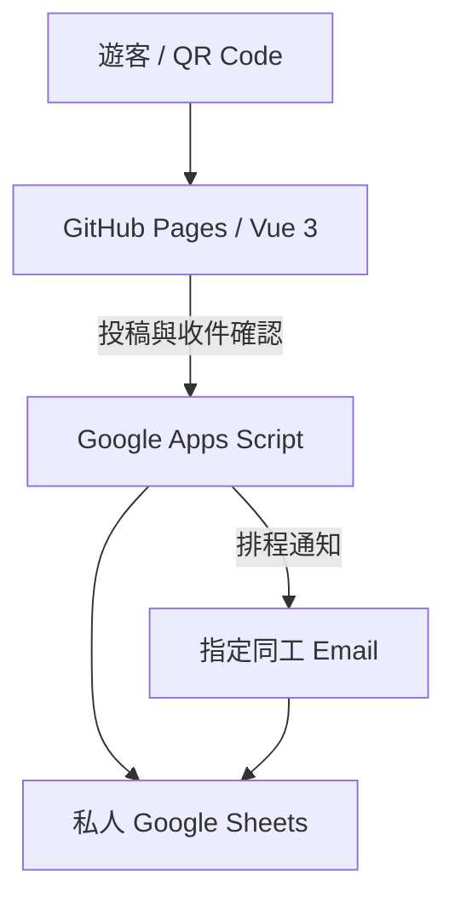

# RENEW｜心事寄放所

> 沒有太小而不值得被聆聽的心事，也沒有太大而不能被禱告的事。

2026 耶YEAH！市集 RENEW 數位代禱與關懷服務。無論有沒有信仰，都歡迎留下生活中的願望、心事與祝福。

**專案狀態：已上線，核心功能完成，持續維護與優化。**

**[前往心事寄放所](https://yeshuayeah1225-tech.github.io/prayer-box/)**

活動日期：2026/12/12–12/13，15:00–20:30｜台塑王氏昆仲公園。

## 功能特色

- 匿名投稿，不需姓名或聯絡資料。
- 具名投稿，可自願接受後續關懷，提供 LINE、Instagram、電話或 Email。
- 選填代禱分類、最多 1,000 字的心事內容。
- 九組代禱靈感主題與隨機虛構範例。
- 官方角色素材、手機響應式介面及站內投稿成功頁。
- 送出期間防止連續點擊，透過投稿識別碼確認收件結果。
- 私人試算表管理代禱及關懷紀錄，排程彙整 Email 通知。

## 系統架構



前端：Vue 3、TypeScript、Vite。部署：GitHub Actions、GitHub Pages。後端：Google Apps Script、Google Sheets、MailApp。

## 本機開發

使用 Node.js 22，與部署流程一致。

```sh
npm install
npm run dev
npm run build
```

主要介面與投稿流程：`src/App.vue`；官方角色素材：`public/art/`；部署流程：`.github/workflows/deploy.yml`。

本機測試請設定獨立測試 API。現行前端具有正式 API 備援網址，未設定環境變數可能寫入正式資料，請勿使用真實個資測試。

## 部署與維護

1. GitHub Settings → Pages 使用 GitHub Actions。
2. Settings → Secrets and variables → Actions → Variables 設定 `VITE_GAS_URL` 為 Apps Script 網頁應用程式的 `/exec` 網址。
3. 推送至 `main` 或手動執行 Deploy Pages workflow。
4. 確認部署成功後，以手機及無痕視窗測試投稿、成功頁、資料寫入與通知。

正式 Apps Script 獨立管理。更新前備份程式及資料，依版本說明執行必要的初始化或修復函式，再更新既有部署以保留 API 網址。

常用指令碼屬性：`SHEET_ID`（私人試算表識別碼）、`OPEN`（投稿開關）、`RECIPIENTS`（通知收件人）。通知排程與其他設定以正式後端及內部交接文件為準。授權管理者可執行 `notifyPending` 測試通知。

## 隱私與安全

- 不得將真實代禱內容或聯絡資料提交至 GitHub。
- 試算表僅限指定同工存取，不得公開分享；通知收件人與試算表權限須分別管理。
- 聯絡資料僅供經同意的後續關懷，不用於行銷。
- 本服務不是即時緊急求助管道。
- 基礎防濫用措施不等同完整安全防護；仍須留意惡意投稿、通知額度、重試及服務中斷風險。
- 活動後依管理團隊決議調整投稿開關、通知排程、資料保存與備份期限。

## 版本紀錄

| 版本 | 更新內容 |
| --- | --- |
| v1.0 | 初始投稿與後台管理架構 |
| v1.1 | 具名投稿、關懷聯絡資料與通知管理 |
| v1.1.2（前端） | RWD、收件確認、站內成功頁與表單重置 |
| 後端 v1.1.3–v1.1.4 | 資料列修復與通知管理優化；正式版本以 Apps Script 部署紀錄為準 |

## 後續維護

以聯絡資料格式檢核、操作體驗、通知及關懷管理的小幅優化為主，並逐步完善同工操作與系統交接文件。正式網址不變時，既有 QR Code 可繼續使用。

---

2026 耶YEAH！市集｜RENEW  
[Instagram @yeshuayeah_bazaar](https://www.instagram.com/yeshuayeah_bazaar/)
